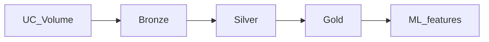

# Architecture

## Overview

NYC Taxi Data Platform implements medallion architecture on Unity Catalog:

| Layer | Schema | Purpose |
|-------|--------|---------|
| Bronze | `nyc_taxi.bronze` | Raw trips, zone lookup, ingestion manifest, audit log |
| Silver | `nyc_taxi.silver` | Standardized trips, quarantine, zones, DQ results |
| Gold | `nyc_taxi.gold` | Hourly facts, zone dimension, ML feature tables |

## Code layout

- `src/nyc_taxi_data_platform/` — transformation and validation logic
- `src/nyc_taxi_data_platform/pipeline/stages.py` — job entry points
- `tests/unit/` — local pytest with PySpark
- `databricks.yml` — Asset Bundle (jobs, variables)

## Time semantics

Pickup/dropoff timestamps are treated as **NYC local wall-clock** (`America/New_York`). The pipeline stores `local_timezone` on silver trips and does not silently convert to UTC.

## Orchestration

Job `nyc_taxi_pipeline`: `init_catalog` → `audit_ping` (extended in workspace as ingest/silver/gold tasks are wired to the same package in later iterations).

## Free Edition notes

- Catalog `nyc_taxi` may need to be created in the UI if CLI `CREATE CATALOG` is denied.
- Use UC Volume uploads instead of cluster-side TLC downloads.
- Validate bundle deploy; fall back to manual job configuration if deploy is blocked.
